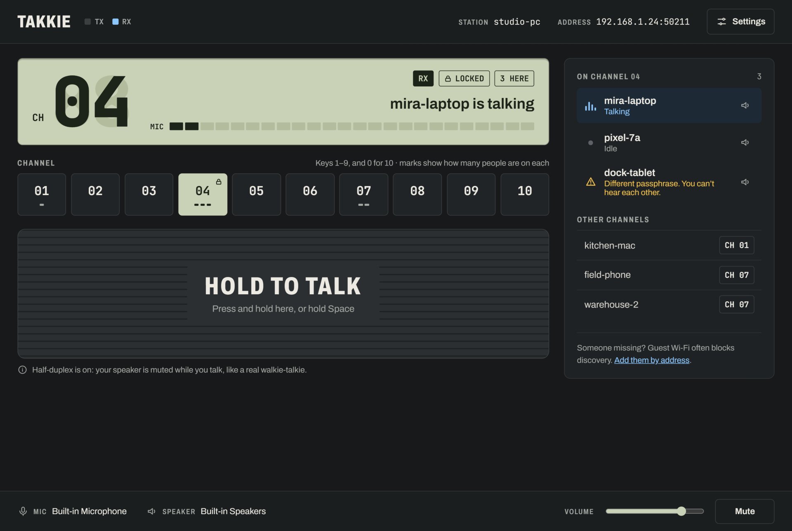
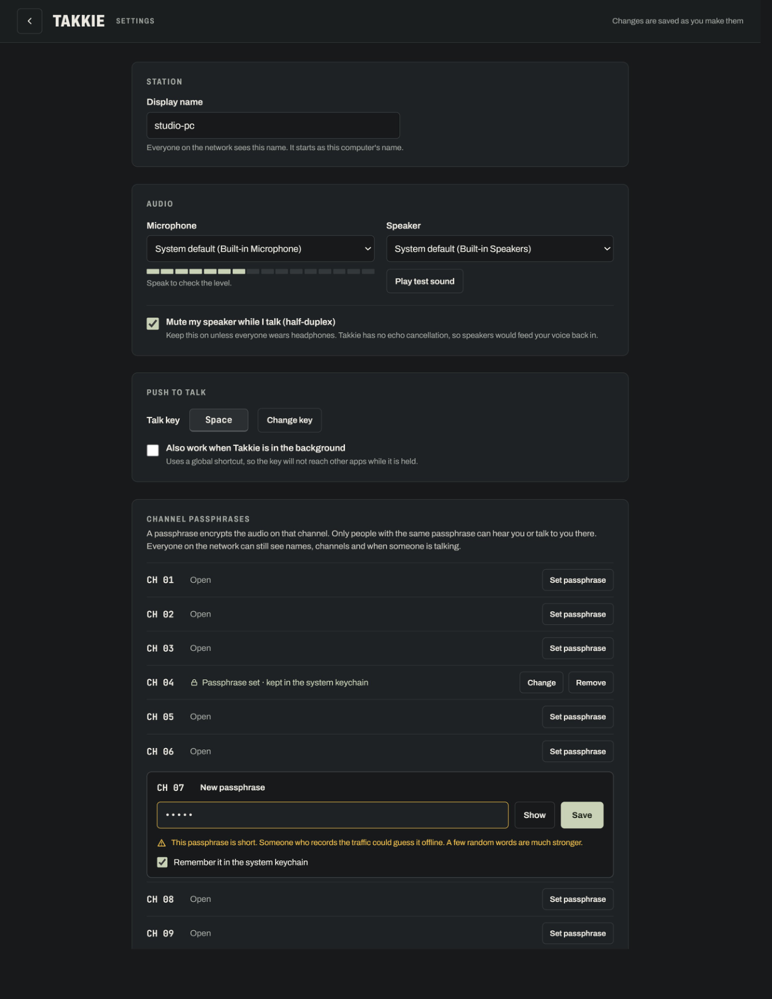
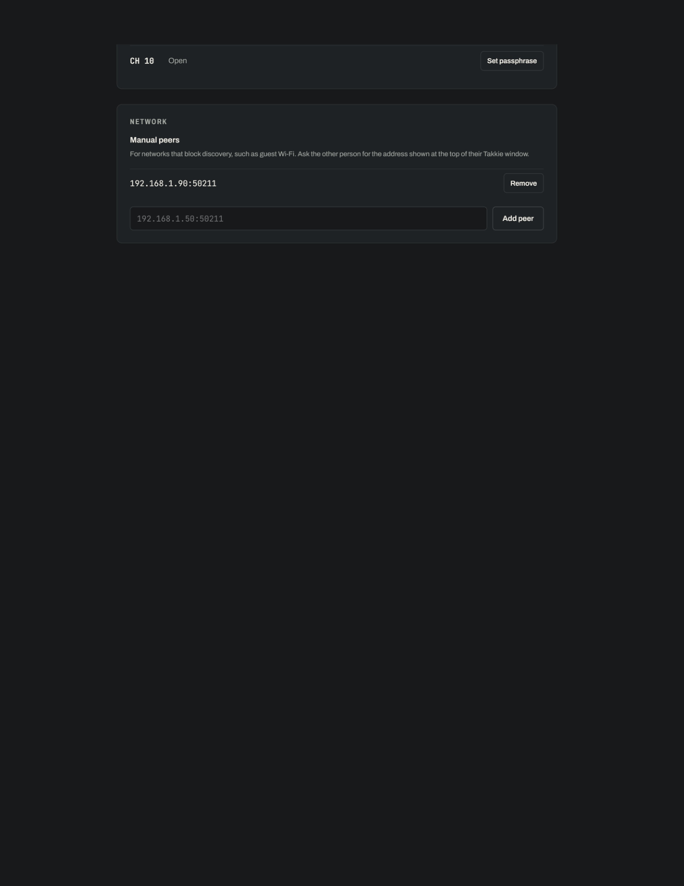
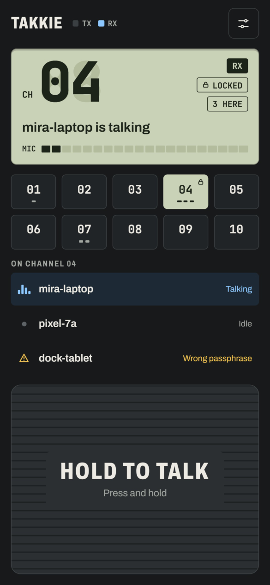
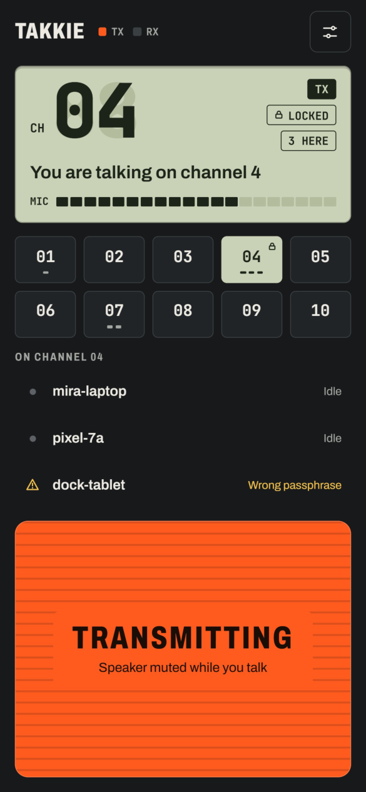
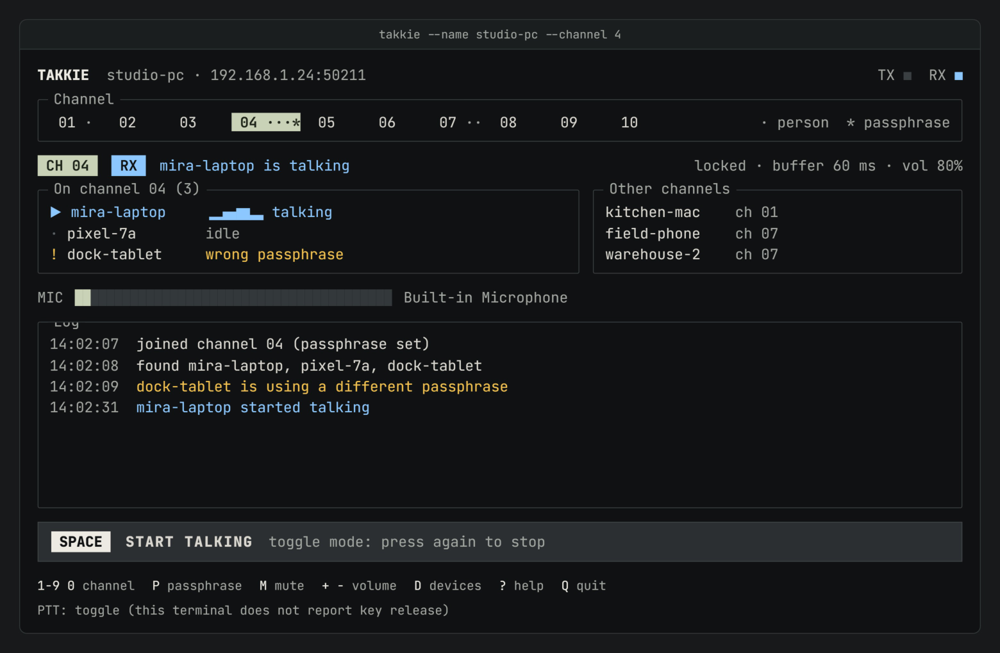
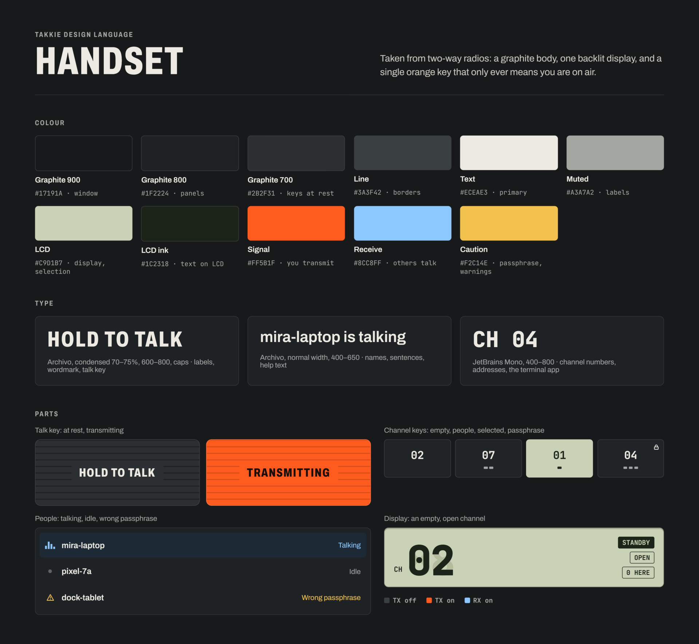

# HANDSET: how Takkie looks

Taken from two-way radios: a graphite body, one backlit display, and a single
orange key that only ever means you are on air. It applies to the desktop
app, the phone app and the terminal app.

The pictures in [handset/](handset/) are the design itself, exported from the
original PDF. This page says what they show and adds what they don't: states
the pictures leave out, and where the things the app has beyond the design go.

## Colour

Dark only: there is no light theme. In the app each colour is a CSS variable
of the same name, and components use the variables, never a literal.

| Name | CSS variable | Value | Used for |
|---|---|---|---|
| Graphite 900 | `--graphite-900` | `#17191A` | window background |
| Graphite 800 | `--graphite-800` | `#1F2224` | panels, channel keys |
| Graphite 700 | `--graphite-700` | `#2B2F31` | the talk key, raised parts |
| Line | `--line` | `#3A3F42` | borders, dividers |
| Text | `--text` | `#ECEAE3` | main text |
| Muted | `--muted` | `#A3A7A2` | labels, secondary text |
| LCD | `--lcd` | `#C9D1B7` | the display, the selected channel key |
| LCD ink | `--lcd-ink` | `#1C2318` | text on the display |
| Signal | `--signal` | `#FF5B1F` | you are transmitting, and nothing else |
| Receive | `--receive` | `#8CC8FF` | someone else is talking |
| Caution | `--caution` | `#F2C14E` | passphrase problems, warnings |

Signal and Receive are never the only sign of a state: a label, a lamp's
position or a shape always says the same thing.

## Type

Both fonts ship inside the app (Takkie works without internet) and are
under the SIL Open Font License.

| Style | Font | Used for |
|---|---|---|
| Label | Archivo, condensed to 70 to 75% width, weight 600 to 800, capitals, a little letter spacing | section labels, the wordmark, the talk key |
| Body | Archivo, normal width, weight 400 to 650 | names, sentences, help text |
| Mono | JetBrains Mono, weight 400 to 800 | channel numbers, addresses, tags on the display, the terminal app |

## Parts

### Talk key

A wide key with horizontal ribs and a plate in the middle holding the label.

| State | Look | Label | Under it |
|---|---|---|---|
| Resting | Graphite 700 ribs, Text label | HOLD TO TALK | "Press and hold here, or hold Space" (phone: "Press and hold") |
| Held | Signal, darker orange ribs, near-black label | TRANSMITTING | "Speaker muted while you talk" when half-duplex is on |
| Latched | Same as held | ON AIR | "Click the headset button to stop". Talking started with the headset button, which stops on its next click or after 30 s of silence |
| Blocked | Resting look, dimmed | HOLD TO TALK | Why: no microphone, no network |

Below the key on the desktop, with an (i): "Half-duplex is on: your speaker
is muted while you talk, like a real walkie-talkie." Only while it is on.

### Channel keys

Ten keys, 01 to 10, in mono. Graphite 800 with a Line border.

| State | Look |
|---|---|
| Empty | Number only |
| People on it | One short dash under the number per person, up to four; five or more show the count instead |
| Passphrase set | A small lock in the top-right corner |
| Selected | LCD background, LCD ink number and dashes |

The states combine: the selected key in the design has people and a lock.

### The display

The LCD panel at the top of the main screen.

- **Channel:** a large two-digit number in heavy mono, with an unlit "88"
  behind it like the segments of a real LCD, and a small "CH" beside it.
- **Tags**, mono capitals, top right: the state (filled), then OPEN or
  LOCKED with a lock (outlined), then "N HERE", the number of other people
  on the channel (outlined).
- **Status line**, body type: what is happening.
- **MIC meter:** 24 segments in LCD ink, unlit ones faint.

| State | Tag | Status line |
|---|---|---|
| Standby | STANDBY | Nobody on the channel: "Nobody else here yet". Otherwise the most useful note below, or "Channel 4 is free" |
| Receiving | RX | "mira-laptop is talking"; two or more: "mira-laptop and 1 more are talking" |
| Transmitting | TX | "You are talking on channel 4" |

The status line also carries what the app used to show elsewhere, in this
order of importance: no network, microphone blocked or lost, microphone too
loud or too quiet, someone with a different passphrase.

### People

A row per person on your channel.

| State | Mark on the left | On the right |
|---|---|---|
| Talking | Bars, Receive; the row is tinted Receive | "Talking" in Receive |
| Idle | Grey dot | "Idle" in Muted |
| Different passphrase | Warning triangle, Caution | "Different passphrase. You can't hear each other." in Caution (phone: "Wrong passphrase") |
| In the room | House | "In the room": the room echo guard isn't playing them |
| Muted by you | Crossed speaker | "Muted" |

On the desktop each row ends in a speaker button that mutes that person for
you only.

### Lamps

Two square lamps beside the wordmark, labelled TX and RX in mono. TX lights
Signal while you transmit; RX lights Receive while someone on your channel
talks. Off, both are Line grey.

## Screens

### 1. Desktop main screen

- **Header:** TAKKIE, the lamps, STATION and its name, ADDRESS (the one
  others can add you by), Settings. With no network the address gives way
  to "No network".
- **Left:** the display, CHANNEL with the keys and their hint ("Keys 1 to 9,
  and 0 for 10"), the talk key and the half-duplex note.
- **Right panel:** ON CHANNEL 04 with the count, the people, OTHER CHANNELS
  (name and a CH key that switches there), and "Someone missing? Guest Wi-Fi
  often blocks discovery. Add them by address."
- **Footer:** MIC and SPEAKER with the device in use, VOLUME and Mute.
- **Log:** a collapsed LOG at the bottom of the right panel, not in the
  design: the latest line shows, a click opens the list.

### 2. Settings

A back arrow, TAKKIE SETTINGS, and "Changes are saved as you make them".
Sections, each a panel:

- **Station:** display name.
- **Audio:** microphone and speaker pickers, the microphone's level, "Play
  test sound", and half-duplex.
- **Sound** (not in the design): beeps, noise removal, even volume,
  clarity, room echo guard; on the phone the headset button and keeping the
  screen on.
- **Push to talk** (desktop only): the talk key with "Change key", and "Also
  work when Takkie is in the background".
- **Channel passphrases:** a row per channel: Open with "Set passphrase", or
  "Passphrase set" with Change and Remove. Setting one opens the row: field,
  Show, Save, and a Caution line when it is short. The keychain switch waits
  for #255; until then passphrases live in memory only.
- **Network:** manual peers, a list with Remove and a field with "Add peer".

Passphrases can also be set from the main screen: the OPEN or LOCKED tag on
the display opens the same editor for the current channel.

### 3. Phone

Drawn at 390 by 844 points. One column: header (wordmark, lamps, a
settings button), display (tags stacked on the right), the keys in two rows
of five, ON CHANNEL, and the talk key at the bottom within reach of a thumb.

Not in the design, below the people list: Other channels, "Add them by
address", and the log.

### 4. Terminal app

The same parts in text: the header with the lamps, a channel row with a dot
per person and `*` for a passphrase, a `CH 04` `RX` status line, ON CHANNEL
and OTHER CHANNELS side by side, the MIC bar, the log, the SPACE bar with the
talk state, the key legend and the push-to-talk mode. In true colour it uses
the palette, elsewhere 16 colours, and with `NO_COLOR` it still reads.

### Design language

